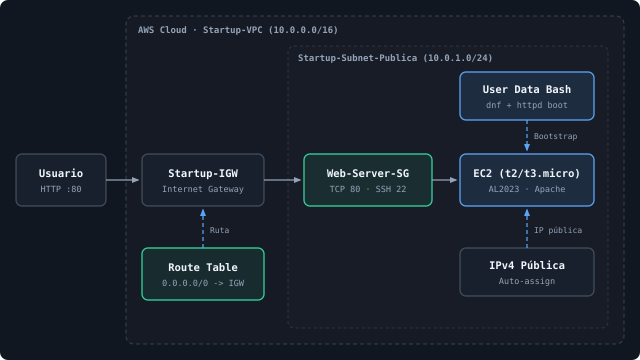
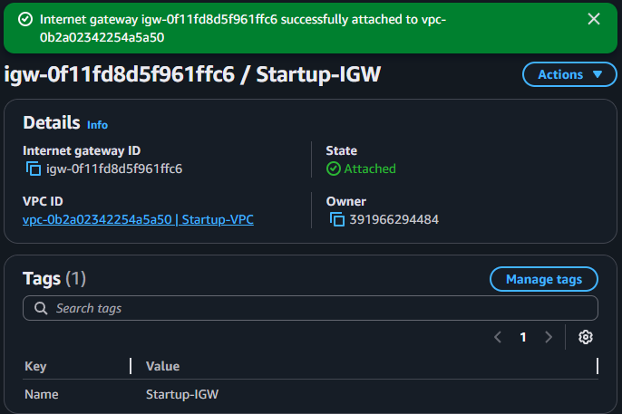
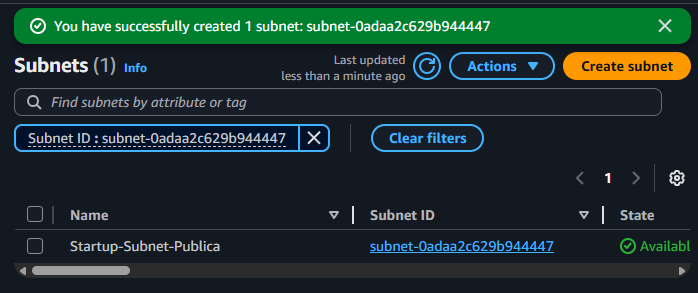
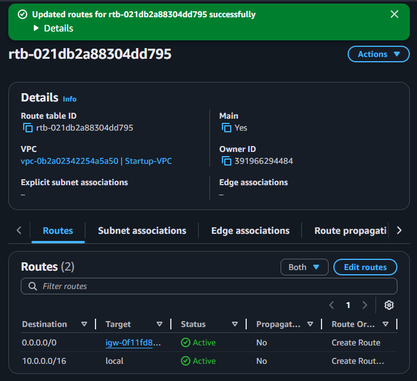
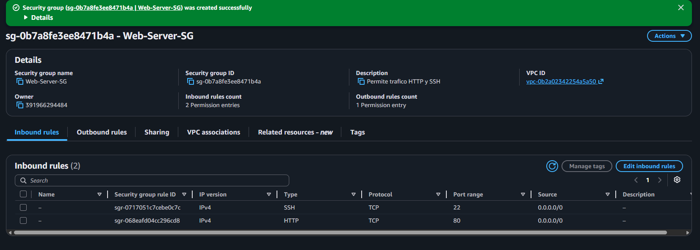
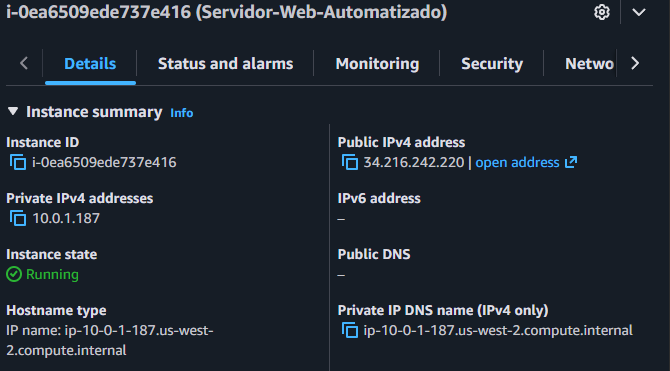
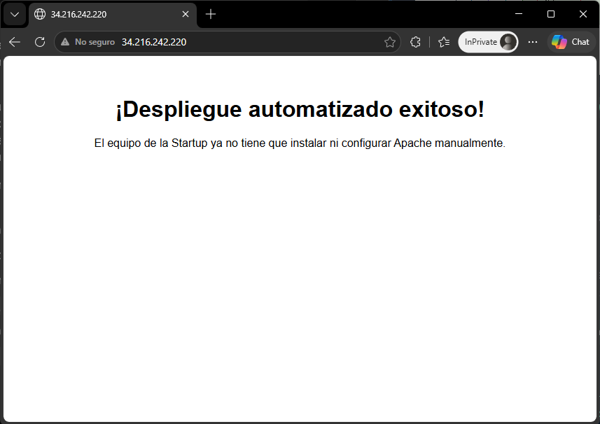

# Automated Web Server Provisioning on AWS VPC

[](https://aws.amazon.com/vpc/)
[](https://aws.amazon.com/linux/amazon-linux-2023/)
[](scripts/user-data.sh)

> Diseño de una red aislada en **Amazon VPC** (`10.0.0.0/16`) con subred pública, enrutamiento vía **Internet Gateway**, firewall perimetral con **Security Groups** y aprovisionamiento desatendido de **Apache (`httpd`)** sobre **Amazon Linux 2023** mediante **EC2 User Data**.

---

## Contexto y Problema

Configurar servidores web manualmente por SSH introduce errores repetitivos, deriva de configuración y lentitud al recrear instancias. Este laboratorio (desarrollado como parte del programa **AWS Cloud re/Start — Generation Chile**) construye desde cero una topología VPC controlada y automatiza la instalación y arranque del servicio web en el primer inicio de la instancia.

---

## Arquitectura del Sistema

Topología de red y flujo de aprovisionamiento implementados en `Startup-VPC`:



---

## Decisiones Técnicas

- **VPC personalizada (`10.0.0.0/16`) en lugar de la Default VPC:** ofrece control explícito del direccionamiento CIDR, subredes (`10.0.1.0/24`) y tablas de ruteo (`0.0.0.0/0 -> Startup-IGW`), preparando la red para crecer hacia subredes privadas.
- **Bootstrapping con EC2 User Data ([scripts/user-data.sh](scripts/user-data.sh)):** ejecuta `dnf update`, instala `httpd`, inicia el servicio y lo habilita con `systemctl enable httpd` para sobrevivir a reinicios sin intervención manual.
- **Amazon Linux 2023 sobre `t2.micro` / `t3.micro`:** imagen mantenida por AWS con integración nativa de `systemd` y `dnf`, optimizada para pruebas bajo Free Tier.

---

## Seguridad e IAM

Controles aplicados en el despliegue actual:
- **Security Group stateful (`Web-Server-SG`):** permite tráfico entrante únicamente en `TCP 80` (`0.0.0.0/0`) para HTTP y `TCP 22` restringido a la IP pública del administrador.
- **Segmentación de red:** recursos desplegados dentro de `Startup-VPC` con enrutamiento explícito solo para la subred pública.

**Hardening previsto para producción:**
- **Eliminar el puerto SSH 22 abierto** y administrar la instancia con **AWS Systems Manager (Session Manager)** mediante un IAM Role con `AmazonSSMManagedInstanceCore`.
- **Mover la EC2 a una subred privada** (sin IP pública) y exponer la aplicación detrás de un **Application Load Balancer (ALB)** con HTTPS/TLS gestionado por **AWS Certificate Manager (ACM)**.
- **Alta disponibilidad:** desplegar en al menos dos Zonas de Disponibilidad mediante **Auto Scaling Group** + **Launch Template**.

---

## FinOps y Control de Costos

- **VPC, Internet Gateway, Route Tables y Security Groups:** **$0.00 USD** (sin costo fijo).
- **Amazon EC2 (`t2.micro` / `t3.micro`):** cubierto por las **750 horas/mes del AWS Free Tier** durante el primer año.
- **Atención a IPv4 pública:** desde febrero de 2024 AWS cobra **$0.005 USD/hora (~$3.60 USD/mes)** por dirección IPv4 pública fuera de la asignación Free Tier; en laboratorios se recomienda **terminar la instancia** al finalizar las pruebas.

---

## Guía de Despliegue y Evidencia

### Pasos resumidos
1. Crear `Startup-VPC` (`10.0.0.0/16`), asociar `Startup-IGW`, crear `Startup-Subnet-Publica` (`10.0.1.0/24`) y agregar ruta `0.0.0.0/0 -> Startup-IGW` en la Route Table.
2. Crear `Web-Server-SG` en `Startup-VPC` (Inbound: `TCP 80` desde `0.0.0.0/0` y `TCP 22` desde tu IP).
3. Lanzar EC2 `t2.micro` / `t3.micro` (Amazon Linux 2023) en `Startup-Subnet-Publica` con IP pública y pegar el contenido de [scripts/user-data.sh](scripts/user-data.sh) en **Advanced Details > User Data**.
4. Verificar respuesta en `http://<IP_PUBLICA>`.

<details>
  <summary><b>Ver evidencia de configuración en consola AWS (6 capturas)</b></summary>

  **1. Asociación de Internet Gateway (`Startup-IGW`):**
  

  **2. Creación de Subred Pública (`10.0.1.0/24`):**
  

  **3. Reglas de la Route Table (`0.0.0.0/0 -> IGW`):**
  

  **4. Reglas Inbound del Security Group (`Web-Server-SG`):**
  

  **5. Instancia EC2 en ejecución con IP pública:**
  

  **6. Servidor Apache activo tras User Data:**
  
</details>

---

## Estructura del Repositorio

```text
aws-automated-web-server/
├── docs/
│   ├── architecture.svg       # Diagrama de arquitectura VPC y bootstrapping
│   └── images/
│       ├── architecture.png   # Diagrama original en Lucidchart
│       └── screenshots/       # Capturas paso a paso en consola AWS
├── scripts/
│   └── user-data.sh           # Script Bash de aprovisionamiento Apache (AL2023)
└── README.md
```

---

## Autor

**Víctor Martínez** — Junior Cloud Engineer | AWS, FinOps & Applied AI  
AWS Certified Cloud Practitioner • AWS Cloud re/Start • En preparación para SAA-C03

- **Portafolio:** [vitonez5198.github.io/Portfolio-VM](https://vitonez5198.github.io/Portfolio-VM/)
- **LinkedIn:** [victor-ms-dev](https://www.linkedin.com/in/victor-ms-dev/)
- **GitHub:** [@VitoNez5198](https://github.com/VitoNez5198)
